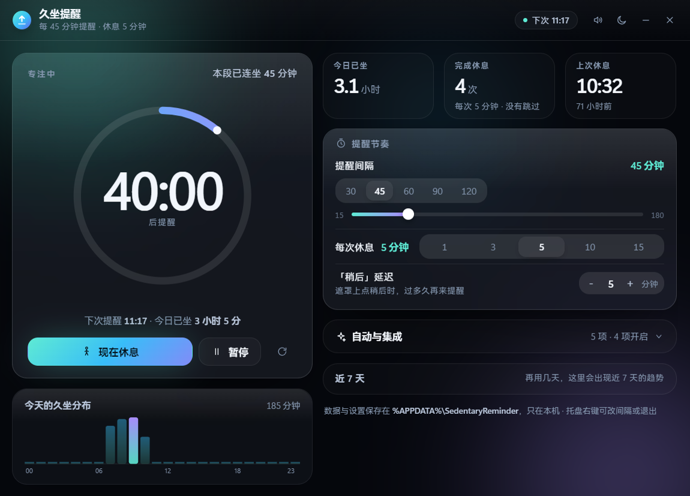

# 久坐提醒 Sedentary Reminder

一个常驻 Windows 托盘的小工具：每隔一段时间提醒你起身，到点弹全屏呼吸遮罩并倒计时休息。
纯本地运行，不联网、不上传任何数据。

[](https://github.com/DOIT008/sedentary-reminder/releases/tag/v1.0.0)

## 下载

到 [Releases 页面](https://github.com/DOIT008/sedentary-reminder/releases) 任选一种：

| 文件 | 适合 | 说明 |
| --- | --- | --- |
| `SedentaryReminder-Setup-1.0.0.exe` | 长期用 | 安装向导，可选目录，创建开始菜单/桌面快捷方式和卸载入口 |
| `SedentaryReminder-Portable-1.0.0.exe` | 不想装 | 单文件，拷到哪跑到哪，不写注册表 |

> 二进制没有代码签名证书，首次运行 Windows 会弹 SmartScreen「未知发布者」。点「仍要运行」即可；
> 介意的话可以 clone 下来自己 `npm run package`，产物和公开的那份逻辑完全一致。

## 它做什么

- **可自定义间隔**：默认 45 分钟提醒一次，15–180 分钟随便调，休息时长 1/3/5/10/15 分钟或自定义。
- **全屏呼吸遮罩**：到点盖住所有窗口和任务栏，倒计时休息，支持「稍后（顺延 N 分钟）」和「跳过」。
- **离开自动暂停**：键鼠闲置超过阈值算「不在」，回来自动顺延，不会一回来就罚你休息。
- **锁屏/睡眠顺延**：合盖、锁屏、睡眠期间不计时，唤醒后按整周期顺延。
- **开机自启 + 托盘常驻**：托盘图标按状态换色（专注/快到了/休息中/已暂停），右键可改间隔、立即休息、退出。
- **统计与打卡**：今日久坐时长、完成休息次数、上次休息时间、24 小时久坐分布、近 7 天趋势。
- **深浅两套主题**，对比度按 WCAG AA 卡过。

数据只存在 `%APPDATA%\SedentaryReminder\state.json`，卸载时想留就留、想删就删。

| 面板 · 浅色 | 面板 · 深色 |
| --- | --- |
|  |  |


## 开发

```bash
npm install --include=dev   # 只装 electron 一个 devDependency
npm start                   # 直接跑，不用打包
```

改完代码后跑门禁，全部退出码 0 才算好：

```bash
npm run test:engine    # 64 项：计时/暂停/顺延/跨天补档等引擎语义（纯 node，无窗口）
npm run test:rollover  #  6 项：跨天补档与启动恢复
npm run test:freeze    #  4 项：面板最小化/收进托盘后仍然走秒
npm run test:clicks    #  7 项：真鼠标点暂停/重置，按钮图标文字与倒计时必须跟着变
npm run test:package   # 20 项：跑打出来的 exe，验 asar/自启/持久化
npm run smoke          # 13 项：真实启动 + 遮罩几何覆盖任务栏
npm run capture        # 13 张不同阶段/主题的截图，出现任何 console error 即失败
```

`test:freeze` / `test:clicks` / `test:package` / `smoke` 会真的弹窗并占用 CDP 端口（9333–9350），
跑之前先退掉常驻的托盘实例。

## 打包

```bash
npm run package
```

[tools/build-exe.js](tools/build-exe.js) 调 electron-builder，同时产出 NSIS 安装版和 portable 单文件，
默认输出到 `E:\builds\sedentary-reminder`（用 `SR_OUT` 覆盖），Electron 与 nsis/7zip 走 npmmirror 镜像。

```bash
npm run release
```

[tools/publish-release.js](tools/publish-release.js) 把两个产物传到当前 tag 的 GitHub Release 附件，
正文带 SHA-256 校验和（见 [RELEASE-NOTES.md](RELEASE-NOTES.md)）。凭据走 `git credential fill`，
脚本不读不写任何 token 文件，重复跑会跳过已上传的附件。

## 目录

```
src/main/       主进程：计时引擎、状态存储、托盘、遮罩窗口、开机自启
src/preload/    contextBridge 白名单（sandbox + contextIsolation，渲染进程碰不到 node）
src/renderer/   面板与遮罩（原生 ES module + CSS，无框架无构建步骤）
tools/          图标生成、打包脚本、上面那一整套门禁
assets/         由 tools/build-icons.js 从矢量定义光栅化出来的图标
```

## 已知限制

- 只有 Windows 版验证过（macOS/Linux 代码路径没测）。
- 全屏遮罩会盖住任务栏，这是刻意的；`npm run smoke` 里有几何断言保证它不会被别的窗口压住。
- 未签名，SmartScreen 会警告。

## 许可

MIT
